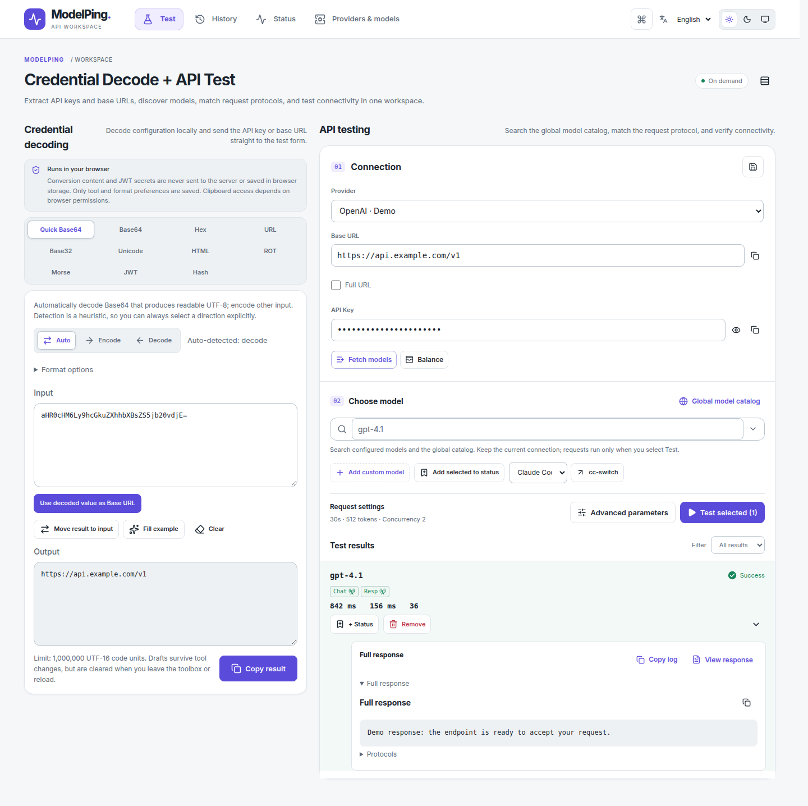
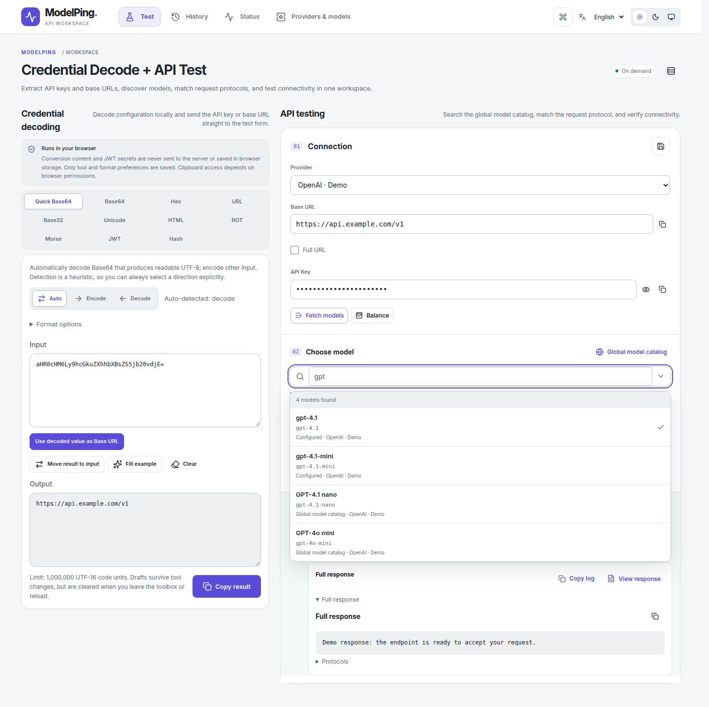
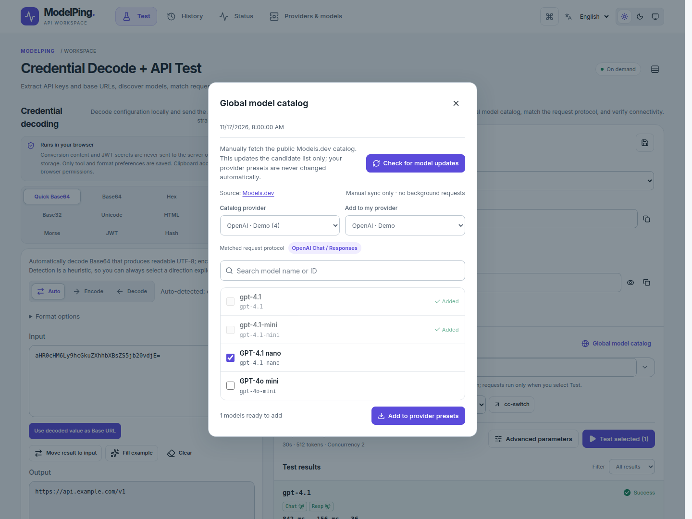
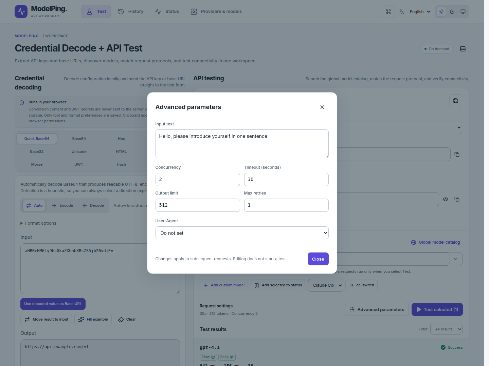
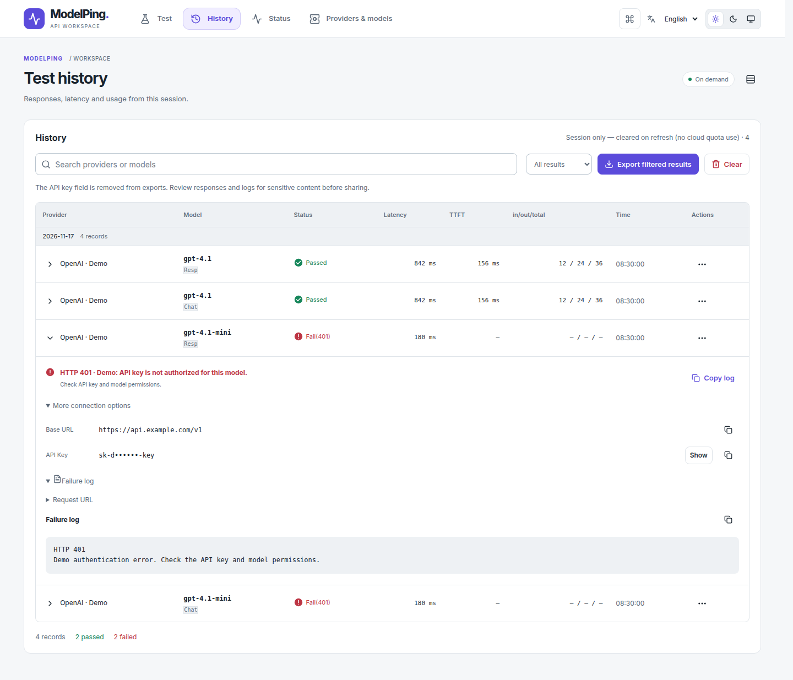
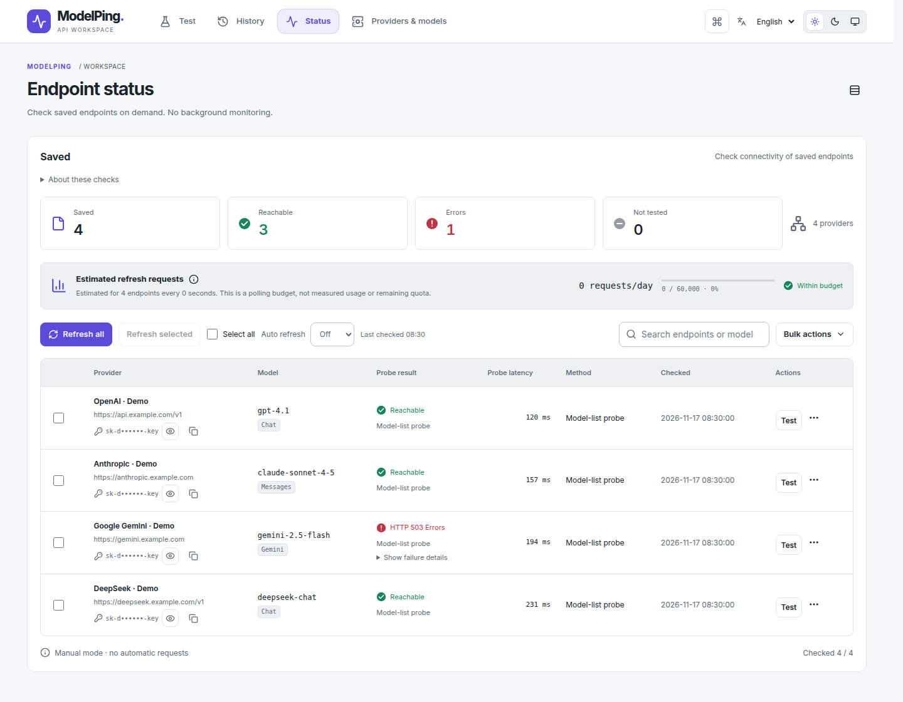
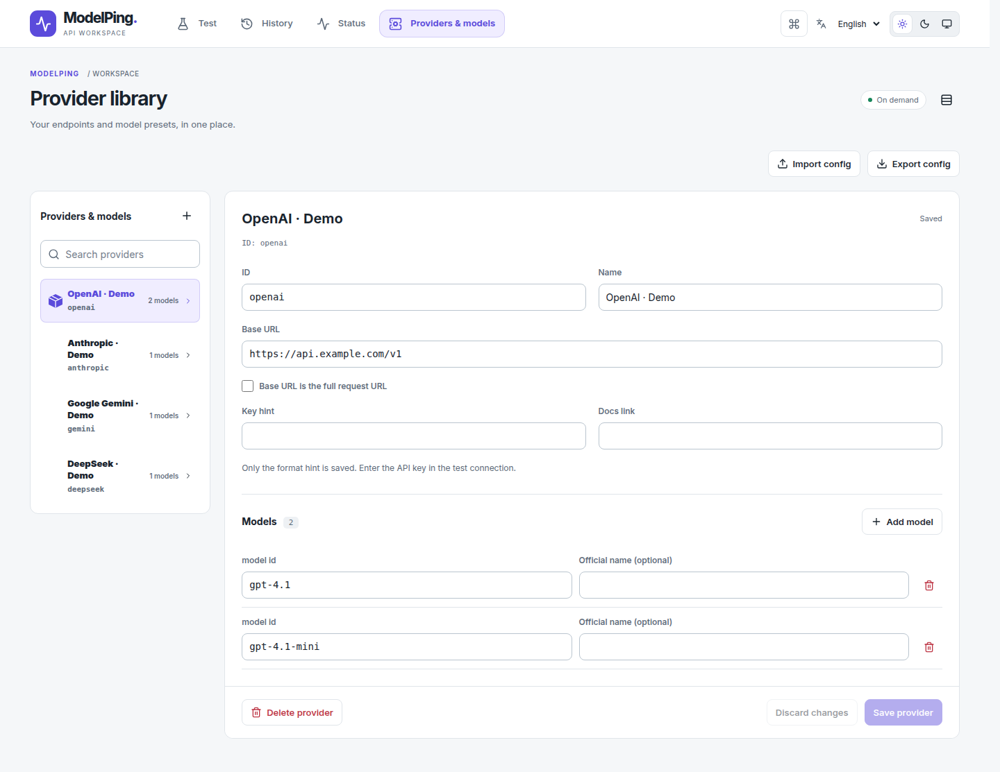
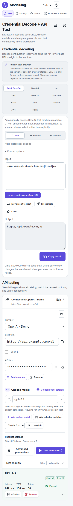

# ModelPing · Credential Decode & API Test

**English** | [简体中文](./README.zh-CN.md)

Decode credentials, choose a model, and test an LLM API in one workspace. ModelPing helps you check protocol compatibility, streaming behavior, response latency, and token usage without writing a test script.

[](https://deploy.workers.cloudflare.com/?url=https://github.com/vdeng-ai/ModelPing)

[Deployment](#deployment) · [Usage](#test-your-first-model) · [Screenshots](#screenshots)



_Screenshots show the real interface with synthetic endpoints, credentials, responses, and timings. They are usage examples, not provider benchmarks._

## What ModelPing does

| Area               | What you can do                                                                                                                                  |
| ------------------ | ------------------------------------------------------------------------------------------------------------------------------------------------ |
| Test               | Decode credentials beside the connection form; search configured models and the global catalog; run the selected model and inspect its response. |
| History            | Search this session's tests, inspect errors and request details, and export the filtered results as JSON.                                        |
| Status             | Save endpoint/model combinations and check reachability manually, with optional automatic refresh while the page is active.                      |
| Providers & models | Edit reusable endpoints and model presets, or import/export provider configuration.                                                              |

The interface supports English and Simplified Chinese, light/dark/system themes, and desktop/mobile layouts. Adding a model, choosing a preset, or editing parameters does not start a test.

## Deployment

Choose Cloudflare Workers for one-click setup with global catalog storage, or run your own Node/Docker or Vercel instance. Configure a strong `APP_PASSWORD` and a separate, randomly generated `PRIVATE_STATE_SECRET` before exposing any instance publicly. Neither value is a model provider's API key.

### Cloudflare Workers — one-click deployment

1. Click **Deploy to Cloudflare** above, sign in to Cloudflare and connect GitHub, then choose your account, new repository name, and Worker name.
2. Review the build settings: production branch `main`, build command `npm run build:cf`, and deploy command `npx wrangler deploy`.
3. Fill in the Worker secrets declared by [.env.example](./.env.example): `APP_PASSWORD` is the instance's access password; `PRIVATE_STATE_SECRET` encrypts saved connection details and Status entries. Use different strong values and keep them out of Git.
4. Confirm the `SETTINGS_KV` binding, then deploy. Open the generated site and verify that it asks for the access password before entering provider credentials. To populate the catalog, open **Global model catalog → Check for model updates** in the app.

The [official deployment flow](https://developers.cloudflare.com/workers/platform/deploy-buttons/) clones the repository into your GitHub account, configures Workers Builds, and provisions the declared KV resource with an account-specific ID. You do not need to manually reuse the KV ID from this repository when using the button. For manual CLI deployment, create your own namespace and replace that ID as described in the [Cloudflare deployment guide](./docs/deployment.md#cloudflare-workers).

Keep `BLOCK_PRIVATE_HOSTS=1` for public deployments. Check your account's actual Workers/KV limits; deployment does not provide model credits. Subsequent pushes to the connected production branch use Workers Builds to redeploy.

### Docker — self-hosted

Clone the repository, configure the two secrets, and choose an image before starting:

```bash
git clone https://github.com/vdeng-ai/ModelPing.git
cd ModelPing
cp .env.example .env
# Edit .env: set APP_PASSWORD and PRIVATE_STATE_SECRET.
# In docker-compose.yml, use an image/tag you published,
# or replace image: with build: . to build locally.
docker compose up -d
# For build: ., use: docker compose up -d --build
```

Open `http://localhost:8787` on the host. Before public access, add HTTPS and destination/egress restrictions. Ensure `./data` is writable by the container's `node` user. The supplied Compose file also runs Watchtower; remove that service to use manual image updates. See [Docker storage and updates](./docs/deployment.md#docker).

### Node — local or server

From a repository checkout, using Node.js 22:

```bash
npm ci
npm run build
cp .env.example .env
# Edit .env: set APP_PASSWORD and PRIVATE_STATE_SECRET.
node --env-file=.env dist/server/node.js
```

Open `http://localhost:8787`. `npm start` is also available when the environment is already supplied by your process manager; it does not load `.env` itself. See [Node storage and configuration](./docs/deployment.md#node).

### Vercel

Import this repository into Vercel and configure `APP_PASSWORD` and `PRIVATE_STATE_SECRET` before deployment. The included [vercel.json](./vercel.json) specifies the build, output directory, and API routes. From a checkout linked to the configured project, deploy with:

```bash
npx vercel --prod
```

Add Blob with `BLOB_READ_WRITE_TOKEN` for persistence; otherwise private state remains in memory. Check your project's function timeout for longer tests. Global catalog storage is currently wired up only on Cloudflare Workers; Node/Docker and Vercel can still use configured models, fetched model lists, and custom IDs. See [Vercel configuration](./docs/deployment.md#vercel).

Full environment-variable, storage, and public-instance security guidance remains in the [deployment reference](./docs/deployment.md). Development setup, testing, and maintenance remain in [docs](./docs/README.md).

## Test your first model

Open a ModelPing instance you trust. You need your provider's **Base URL**, **API key**, and a model ID that your account can access. ModelPing does not supply credentials or model credits. To run your own instance, follow [Deployment](#deployment) above.

### 1. Set up the connection

On **Test**, select a saved provider or use a custom endpoint. Enter the **Base URL** and **API Key**; enable **Full URL** only when supplying the complete request endpoint rather than a base URL.

Encoded values can be decoded in the **Credential decoding** panel on the same page. Choose the matching format, inspect the output, and use **Use decoded value as API key** or **Use decoded value as Base URL**. Transfer fills the form; it does not send a model request. You can also paste plain values directly.

### 2. Find and select a model

Type a model name, request ID, or catalog provider into **Choose model**. Results combine configured models and the cached global catalog. Selecting a catalog entry uses its actual model ID, keeps your current connection and credentials, and does not require importing it into a provider preset first.

Use **Global model catalog**, next to the model heading, to browse sources, **Check for model updates**, or explicitly add models to a provider preset. Searching uses the existing snapshot; only the update button contacts the upstream catalog.

**Catalog availability:** the current catalog storage integration requires Cloudflare Workers with `SETTINGS_KV`. Node/Docker and Vercel do not currently wire up this store. Without it, use configured models, **Fetch models**, or **Add custom model**. Catalog membership is not proof that your endpoint or API key can use a model.

**Fetch models** reads the current provider's model list and lets you add selected IDs. **Add custom model** accepts an ID directly. These actions add choices, not generation requests.

### 3. Adjust parameters and run

Open **Advanced parameters** next to the test button to change the prompt, timeout, output limit, retries, concurrency, or User-Agent. Closing this dialog keeps the changes for subsequent requests.

| Setting        | Initial value                                                       |
| -------------- | ------------------------------------------------------------------- |
| Prompt         | A short self-introduction request, following the interface language |
| Timeout        | 30 seconds                                                          |
| Maximum output | 512 tokens                                                          |
| Retries        | 1                                                                   |
| Concurrency    | 2                                                                   |
| User-Agent     | No override                                                         |

Restored settings may replace these initial values. Select **Test selected (1)** to test the active model. ModelPing checks the protocols appropriate to the connection and model, including non-streaming and streaming requests. One click can send multiple upstream requests and consume provider credits.

### 4. Inspect the result

Read the protocol badges, pass/fail state, latency, time to first token, and usage below the test controls. Expand a result for response text or failure details. Missing upstream usage data is shown as unavailable, not zero. Use the result filter to show successful, failed, or pending results.

| Protocol                | Request format                                |
| ----------------------- | --------------------------------------------- |
| OpenAI Chat Completions | `/chat/completions`                           |
| OpenAI Responses        | `/responses`                                  |
| Gemini native           | `:generateContent` / `:streamGenerateContent` |
| Anthropic Messages      | `/v1/messages`                                |

Protocol selection depends on the current connection and model, not just the catalog source. A compatible gateway may expose a model through a different protocol than its original vendor.

## Other useful actions

**Local decoding.** Quick Base64, Base64, Hex, URL, Base32, Unicode, HTML, ROT, Morse, JWT, and hashes run in the browser. Conversion supports examples, direction/format controls, copying, and moving output back to input. Drafts clear when you leave Test or reload; only tool preferences are saved. See the [decoding reference](./docs/credential-decoding.md) for formats and JWT limitations. Decoding a credential does not prove it is valid or trustworthy.

**History.** Open **History** to review tests from the current page session. Navigation preserves this history; reloading clears it. **Export filtered results** omits the explicit API-key field, but you should still inspect response bodies and logs before sharing.

**Status.** Use **Add selected to Status** in the model actions. A saved entry does not run a check. Status opens in manual mode; automatic refresh is opt-in and pauses when hidden or offline. **Reachable** means the model-list endpoint responded, not that a particular model can generate. A fallback minimal-generation check can consume tokens. Use Test for model-level verification.

**Providers and helpers.** Save reusable endpoints and model IDs in **Providers & models**. Presets do not contain API keys. **Balance** queries supported providers; **cc-switch** transfers the selected connection/model to a compatible local installation. Review the destination before importing credentials. Model actions are directly visible rather than hidden in a More menu.

**Keyboard.** Press `Ctrl/Cmd + K` to jump between pages, or `/` outside a text field to focus the page's search. In model search, use arrow keys and Enter to choose, Escape to dismiss, and Tab to move on.

## Screenshots

<details>
<summary>Model search, catalog, parameters, history, status, providers, and mobile</summary>

**Search configured models and the global catalog**



**Browse and import from the catalog**



**Request parameters**



**Session history and failure diagnostics**



**Endpoint status**



**Provider configuration**



**Mobile workspace**



</details>

## Privacy and safe use

Decoding stays local. Testing, fetching models, and querying balances send the connection information through the ModelPing backend to the target provider. Use only an instance and endpoint you trust.

When encrypted private-state storage is configured, connection details and saved Status entries, including API keys, can be persisted on the server. Otherwise they remain in memory. Test history is session-only even when private-state storage is enabled. Transferring decoded output into the connection form makes it part of that connection state.

Do not share real credentials, unreviewed logs, or sensitive screenshots. Public instances require access controls; see [deployment and security](./docs/deployment.md).

## Documentation and license

[Documentation](./docs/README.md) contains development, testing, detailed deployment/configuration, and maintenance instructions. Deployment quick starts are included above.

Released under the [MIT License](./LICENSE). Provider presets reference [cc-switch](https://github.com/farion1231/cc-switch); the optional global catalog uses [Models.dev](https://models.dev/). See [third-party notices](./web/public/assets/toolbox-licenses.txt). ModelPing does not guarantee third-party availability, account access, or billing.
