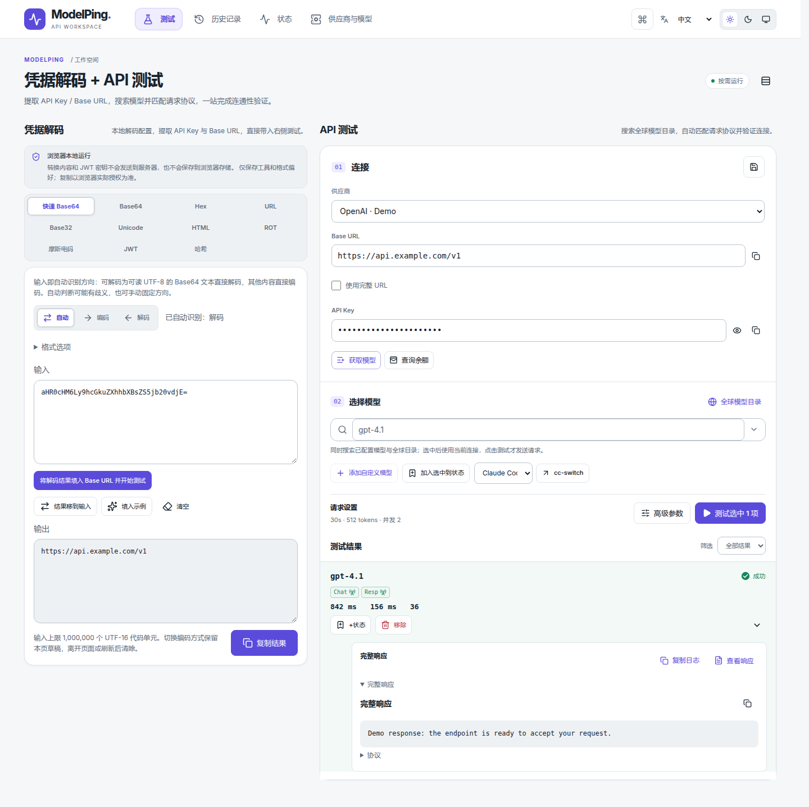
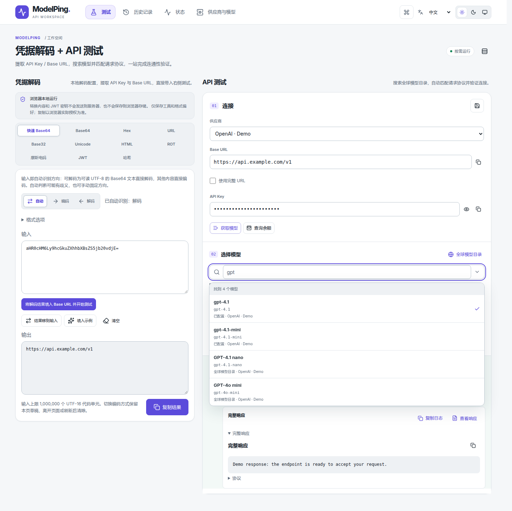
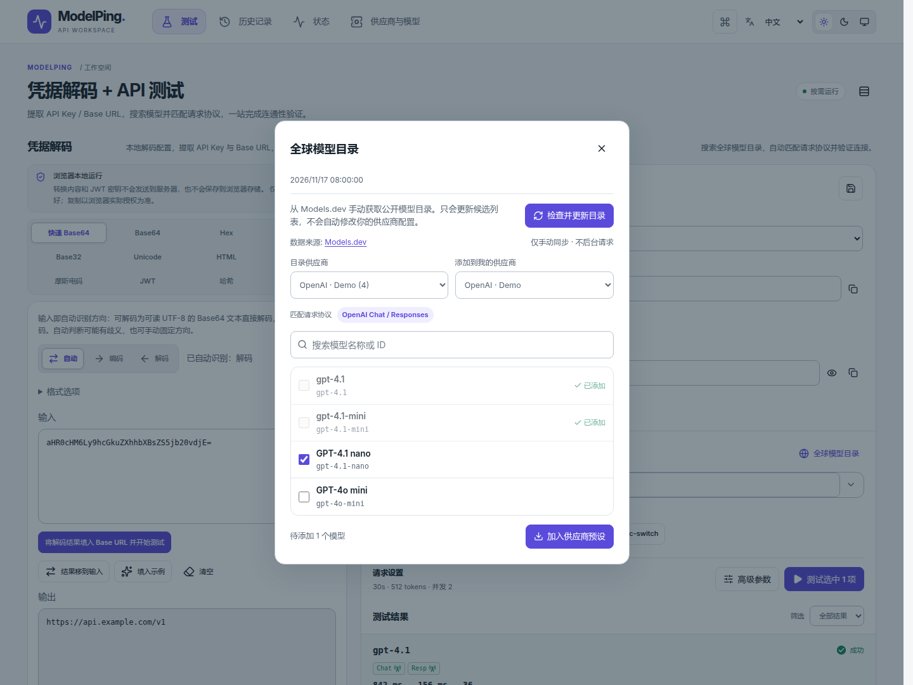
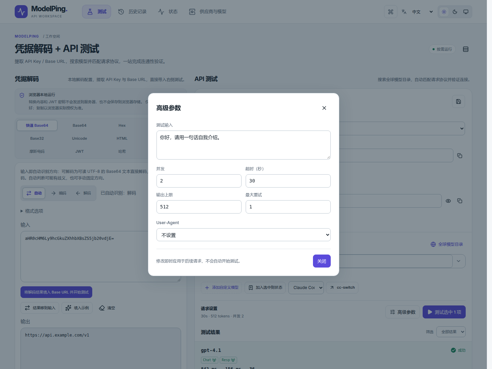
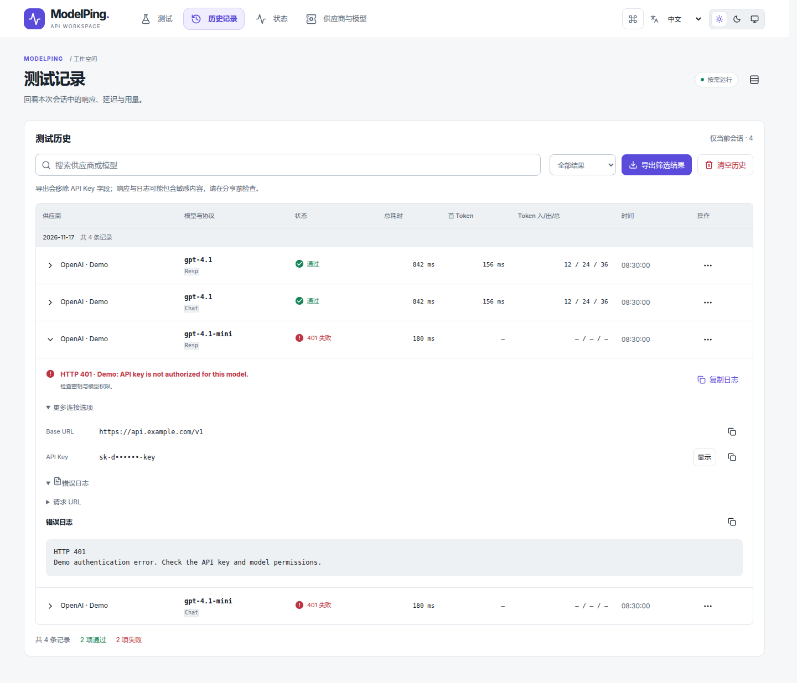
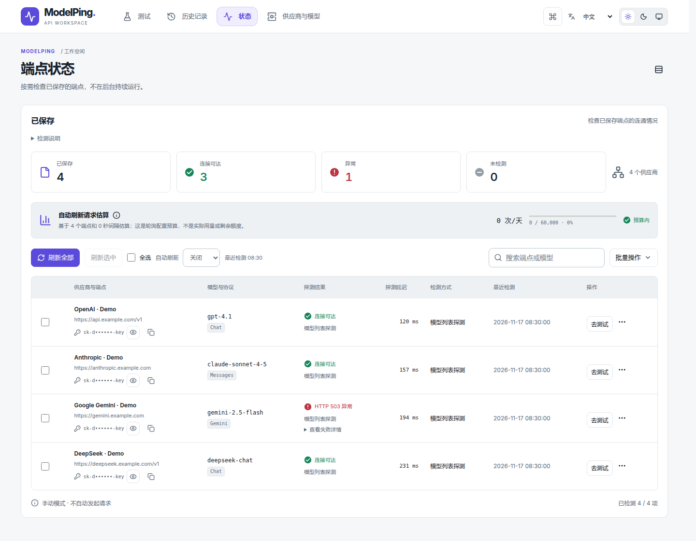
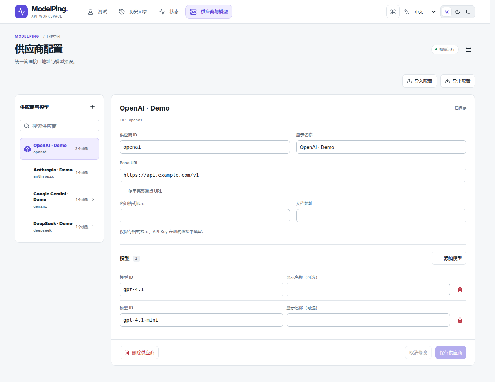
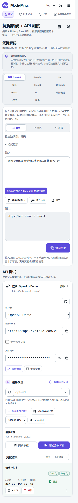

# ModelPing · 凭据解码与 API 测试

[English](./README.md) | **简体中文**

在一个工作区内完成凭据解码、模型选择和大模型 API 测试。不用编写测试脚本，即可检查协议兼容性、流式响应、请求延迟和 Token 用量。

[](https://deploy.workers.cloudflare.com/?url=https://github.com/vdeng-ai/ModelPing)

[部署说明](#部署) · [使用说明](#完成第一次测试) · [界面截图](#界面截图)



_截图来自实际界面，端点、凭据、响应和耗时均为模拟数据，仅用于演示操作，不代表供应商实测结果。_

## 项目能做什么

| 页面         | 用途                                                                         |
| ------------ | ---------------------------------------------------------------------------- |
| 测试         | 同屏解码凭据、填写连接，搜索已配置模型与全球目录，测试选中的模型并查看响应。 |
| 历史记录     | 搜索本次会话的测试，查看错误和请求详情，将筛选结果导出为 JSON。              |
| 状态         | 保存常用端点与模型组合，手动检查连通性，也可在页面活跃时开启自动刷新。       |
| 供应商与模型 | 管理可复用的接口地址和模型预设，导入、导出供应商配置。                       |

支持中英文、浅色／深色／跟随系统主题，以及桌面和移动端布局。添加模型、选择预设或修改参数都不会自动开始测试。

## 部署

需要一键部署和全球目录存储时可选 Cloudflare Workers，也可使用 Node／Docker 自托管或 Vercel。任何实例公开前，都应设置强 `APP_PASSWORD` 和独立随机生成的 `PRIVATE_STATE_SECRET`；这两个值都不是模型供应商的 API Key。

### Cloudflare Workers — 一键部署

1. 点击上方 **Deploy to Cloudflare** 按钮，登录 Cloudflare 并连接 GitHub，选择账号、新仓库名称和 Worker 名称。
2. 检查构建设置：生产分支 `main`，构建命令 `npm run build:cf`，部署命令 `npx wrangler deploy`。
3. 按 [.env.example](./.env.example) 中声明的名称填写 Worker secrets：`APP_PASSWORD` 是实例访问口令；`PRIVATE_STATE_SECRET` 用于加密保存连接信息和状态条目。使用两个不同的高强度值，不要提交到 Git。
4. 确认 `SETTINGS_KV` 绑定后部署。打开生成的站点，先验证访问口令提示，再输入供应商凭据。需要填充模型目录时，在应用内点击「全球模型目录 → 检查并更新目录」。

[官方一键部署流程](https://developers.cloudflare.com/workers/platform/deploy-buttons/)会将仓库克隆到你的 GitHub 账号，配置 Workers Builds，并创建所需 KV 资源、写入你账号对应的 ID。走按钮流程无须手动复用本仓库中的 KV ID；手动 CLI 部署则需要创建自己的命名空间并替换该 ID，详见 [Cloudflare 部署参考](./docs/deployment.zh-CN.md#cloudflare-workers)。

公网部署保留 `BLOCK_PRIVATE_HOSTS=1`。Workers／KV 额度以账号实际配置为准，部署不包含模型调用额度。后续向关联的生产分支推送代码，由 Workers Builds 自动重新部署。

### Docker — 自托管

克隆仓库，设置两项密钥并选择镜像后启动：

```bash
git clone https://github.com/vdeng-ai/ModelPing.git
cd ModelPing
cp .env.example .env
# 编辑 .env，填写 APP_PASSWORD 和 PRIVATE_STATE_SECRET。
# 将 docker-compose.yml 中的 image: 改为实际发布的镜像与标签，
# 或将 image: 替换为 build: .，改用本机构建。
docker compose up -d
# 使用 build: . 时执行：docker compose up -d --build
```

在宿主机打开 `http://localhost:8787`。公网访问前配置 HTTPS 和目标主机／出站限制，并确保 `./data` 允许容器内 `node` 用户写入。默认 Compose 还包含 Watchtower；不需要自动更新镜像时移除该服务。卷挂载和更新方式见 [Docker 部署参考](./docs/deployment.zh-CN.md#docker)。

### Node — 本地或服务器

使用 Node.js 22，在仓库目录执行：

```bash
npm ci
npm run build
cp .env.example .env
# 编辑 .env，填写 APP_PASSWORD 和 PRIVATE_STATE_SECRET。
node --env-file=.env dist/server/node.js
```

打开 `http://localhost:8787`。进程管理器已注入环境变量时也可用 `npm start`；该命令不会自行读取 `.env`。存储路径和配置方式见 [Node 部署参考](./docs/deployment.zh-CN.md#node)。

### Vercel

在 Vercel 导入本仓库，部署前设置 `APP_PASSWORD` 和 `PRIVATE_STATE_SECRET`。仓库中的 [vercel.json](./vercel.json) 已声明构建命令、输出目录和 API 路由。已关联并配置好项目的本地仓库可执行：

```bash
npx vercel --prod
```

需要持久化时接入 Blob 并配置 `BLOB_READ_WRITE_TOKEN`，否则私有工作态仅保留在内存中。长时间测试需检查实际项目的函数超时限制。全球目录存储目前仅接入 Cloudflare Workers；Node／Docker 和 Vercel 仍可使用已配置模型、获取模型列表及自定义 ID。详见 [Vercel 部署参考](./docs/deployment.zh-CN.md#vercel)。

完整环境变量、存储策略和公网安全配置见[部署参考](./docs/deployment.zh-CN.md)；开发运行、测试和维护说明继续放在 [docs](./docs/README.zh-CN.md)。

## 完成第一次测试

打开一个可信的 ModelPing 实例，准备供应商的 **Base URL、API Key，以及账号有权调用的模型 ID**。项目不提供密钥或模型额度。需要自行运行时，按照上方[部署说明](#部署)操作。

### 1. 填写连接信息

进入「测试」，选择已保存的供应商，或使用自定义接口。填写 **Base URL** 和 **API Key**。只有输入的是完整请求端点而非基础地址时，才勾选「完整 URL」。

拿到编码后的值时，在同页「凭据解码」区域选择格式，检查输出，再点击将结果带入 API Key 或 Base URL 的按钮。带入只填充表单，不发送模型请求；明文凭据也可以直接粘贴。

### 2. 搜索并选择模型

在「选择模型」输入名称、请求 ID 或目录供应商名称。候选结果合并已配置模型和缓存中的全球目录。选中目录模型后使用其**实际请求 ID**，保留当前连接与密钥，无须先导入供应商预设。

模型标题旁的「全球模型目录」可浏览来源、点击「检查并更新目录」，或明确将模型加入供应商预设。输入关键词只筛选已有快照，只有更新按钮才会请求上游目录。

**目录可用性：**当前目录存储仅接入绑定 `SETTINGS_KV` 的 Cloudflare Workers；Node／Docker 和 Vercel 暂未接入该存储。目录不可用时，仍可选择已有模型、「获取模型」或「添加自定义模型」。目录收录不代表当前接口或 API Key 一定有调用权限。

「获取模型」读取当前供应商的模型列表，支持搜索、多选后添加；「添加自定义模型」可直接填写 ID。两者只增加候选项，不发起生成请求。

### 3. 设置参数并测试

点击测试按钮旁的「高级参数」，在同一个弹窗内调整输入文本、超时、输出上限、重试、并发和 User-Agent。关闭弹窗后，修改保留并用于后续请求。

| 参数       | 初始值                         |
| ---------- | ------------------------------ |
| 输入文本   | 跟随界面语言的一句自我介绍请求 |
| 超时       | 30 秒                          |
| 最大输出   | 512 Token                      |
| 重试次数   | 1                              |
| 并发数     | 2                              |
| User-Agent | 不覆盖运行时默认值             |

恢复的个人设置可能覆盖这些初始值。点击「测试选中 1 项」测试当前模型；程序根据连接和模型匹配协议，检查非流式及流式请求。**一次点击可能产生多个上游请求，并消耗供应商额度。**

### 4. 查看结果

在下方查看协议徽章、成功／失败状态、延迟、首 Token 延迟和用量，展开结果可查看响应文本或失败详情。上游未返回的用量显示为不可用，不按零计算。结果筛选支持成功、失败和待测。

| 协议                    | 请求格式                                      |
| ----------------------- | --------------------------------------------- |
| OpenAI Chat Completions | `/chat/completions`                           |
| OpenAI Responses        | `/responses`                                  |
| Gemini 原生             | `:generateContent` / `:streamGenerateContent` |
| Anthropic Messages      | `/v1/messages`                                |

协议匹配依据当前连接与模型，不仅取决于目录来源；兼容网关可能使用不同于原厂的请求协议。

## 其他常用操作

**本地解码。** 快速 Base64、Base64、Hex、URL、Base32、Unicode、HTML、ROT、摩斯电码、JWT 和哈希均在浏览器内运行，支持示例、方向／格式选项、复制和结果回填。离开测试页或刷新后清除草稿，仅保留工具偏好。格式和 JWT 限制见[凭据解码参考](./docs/credential-decoding.zh-CN.md)。解码成功不代表凭据有效或可信。

**历史记录。** 查看当前页面会话的测试；切换导航不会丢失，刷新页面会清空。「导出筛选结果」移除明确的 API Key 字段，但分享前仍应检查响应正文和日志。

**状态检查。** 在模型操作区点击「加入选中到状态」。保存条目不会自动探测；进入状态页默认手动模式，自动刷新需要主动开启，并在页面隐藏或离线时暂停。「连接可达」只说明模型列表端点有响应，不保证某个模型能生成；回退的最小生成探测可能消耗 Token。模型级验证请使用「测试」。

**供应商与辅助功能。** 在「供应商与模型」保存接口地址和模型 ID，预设不包含 API Key。「查询余额」用于查询受支持供应商的额度；「cc-switch」将当前连接与模型导入兼容的本机应用，导入凭据前请确认目标。模型操作直接展示，不再藏在「更多」中。

**键盘操作。** `Ctrl/Cmd + K` 跳转页面，在非输入状态按 `/` 聚焦当前页搜索。模型搜索支持方向键定位、Enter 选择、Escape 关闭，以及 Tab 离开。

## 界面截图

<details>
<summary>模型搜索、全球目录、高级参数、历史记录、状态、供应商与手机端</summary>

**搜索已配置模型与全球目录**



**目录浏览与导入**



**请求参数**



**会话历史与错误详情**



**端点状态**



**供应商配置**



**移动端工作区**



</details>

## 隐私与安全使用

解码在本地完成；实际测试、拉取模型和查询余额会把连接信息交给 ModelPing 后端，再转发到目标供应商。仅使用可信实例与目标接口。

启用加密私有工作态存储时，连接信息和保存的状态条目（包括 API Key）可以在服务端持久化；不可用时仅在内存中保留。**测试历史始终仅限当前会话**，不会因开启存储而持久化。解码结果带入连接表单后，也遵循连接信息的保存规则。

不要分享真实密钥、未经检查的日志或含敏感内容的截图。公网实例需要访问控制，详见[部署与安全说明](./docs/deployment.zh-CN.md)。

## 文档与许可证

README 保留部署上手步骤；开发、测试、详细部署／环境配置和维护说明见 [docs 文档导航](./docs/README.zh-CN.md)。

项目以 [MIT 许可证](./LICENSE) 开源。供应商预设参考 [cc-switch](https://github.com/farion1231/cc-switch)，可选全球目录来自 [Models.dev](https://models.dev/)，另见[第三方许可证](./web/public/assets/toolbox-licenses.txt)。ModelPing 不保证第三方服务可用性、账号权限或计费结果。
